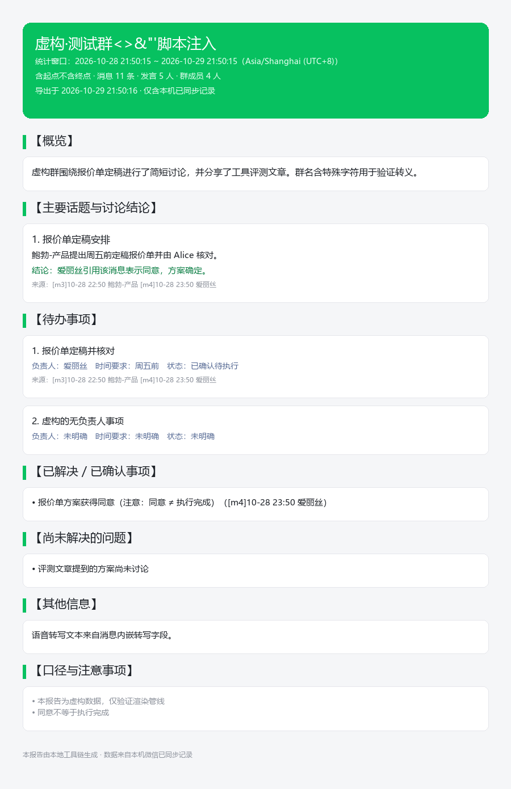

# wechat-group-summary

[WorkBuddy](https://www.workbuddy.cn) Skill：读取本机已登录 Windows 微信 4.x 的群聊本地聊天记录，自动生成**中文总结报告 + 离线 HTML 网页 + PNG 长图 + 结构化消息数据**。



## 功能

- 按「完整群名 + 时间窗口」（默认最近 24h，支持 48h/72h/自定义起止）导出群消息
- 自动完成：密钥提取 → SQLCipher 解密（临时副本）→ WAL 合并 → server_id 去重 → 发送人昵称映射（备注优先）
- 解析文本、引用、链接/文章/文件卡片、语音内嵌转写；图片/视频/表情做类型标记（不虚构内容）
- AI 通读全部消息后撰写总结：概览、话题与结论、待办、已确认事项、未解决问题，每个结论关联消息 ID 可溯源
- 渲染离线 HTML（零外部依赖，手机/电脑自适应）与 PNG 长图（中文字体自动回退，超长自动分页）

## 环境要求

- Windows 10/11 + 微信 4.x（已在本机登录并运行）
- [WorkBuddy](https://www.workbuddy.cn)（加载本 Skill 的 AI 助手）
- Python 3.13+（WorkBuddy 托管环境自带），依赖 `pillow`、`zstandard`
- 已在微信 **4.1.15.56** 上实测通过

## 安装

将本仓库整个目录复制到 WorkBuddy 用户级技能目录：

```
~/.workbuddy/skills/wechat-group-summary/
```

重启会话后，对 WorkBuddy 说「总结一下 XX 群的聊天记录」即可触发。

## 使用

无需手动命令——直接用自然语言，例如：

- 「总结一下『XX 群』最近 24 小时的聊天记录」
- 「把 XX 群 10 月 20 日到 10 月 27 日的消息做成报告」

也可以手动运行（在目标输出目录下）：

```bash
PY="$HOME/.workbuddy/binaries/python/envs/default/Scripts/python.exe"
CLI="$HOME/.workbuddy/skills/wechat-group-summary/scripts/wxsum_cli.py"

"$PY" "$CLI" groups                            # 列出本机群聊
"$PY" "$CLI" export --group "完整群名" --range 24h   # 导出消息
"$PY" "$CLI" render --dir "outputs/<导出目录>"        # 渲染 HTML/PNG
```

不碰微信的回归自检：`"$PY" scripts/selftest_fake.py`

## 安全与隐私设计

- 原始数据库**全程只读**；先复制一致性快照再解密
- 密钥只在内存中短暂使用，不写入任何文件、日志或仓库
- 临时明文库退出时**先覆写再删除**
- 全部数据留在本机，无任何网络上传；HTML 不引用外部资源、不部署公网
- 多账号机器自动锁定当前登录账号，不混读

## 法律与使用边界

本工具仅供**读取你本人账号**在本机已同步的数据。使用者须遵守所在司法辖区的法律法规与平台用户协议，**不得用于读取他人账号或未经授权的数据**。作者不对任何滥用行为负责。

## 致谢

- 解密能力复用 [TANGandXUE/wcdb-key-tool](https://github.com/TANGandXUE/wcdb-key-tool)（MIT，已内置于 `scripts/vendor/`，固定提交 79f1b5b，保留其 LICENSE）

## License

MIT（`scripts/vendor/wcdb-key-tool/` 保留其原始 MIT 许可与版权声明）
